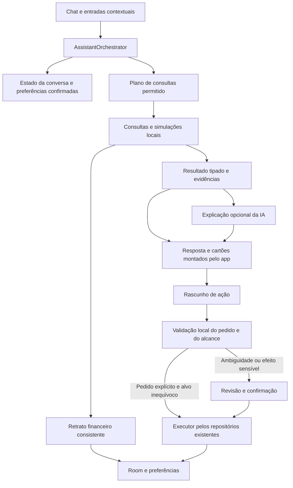

# Reestruturação do assistente financeiro do FinAI

Data: 14/11/2026. Estado: proposta baseada em leitura do repositório; não implementada.

Ampliação de 14/11/2026: tool calling com escolha autônoma de ferramentas e execução de ações explicitamente autorizadas no chat. A seção 5.10 detalha o contrato e exemplos. Esta ampliação é planejamento, não autorização para alterar agora os registros financeiros do usuário.

## 1. Direção do produto

O assistente deve ajudar o usuário a entender sua situação, tomar decisões, transformar decisões em ações confirmadas e acompanhar o resultado. O chat passa a ser uma interface para as capacidades financeiras do aplicativo.

“Completo” neste escopo significa integrar receitas, gastos, contas, cartões, dívidas, metas, reservas, orçamento, cenários e acompanhamento. Não significa conhecer movimentações não cadastradas, condições de negociação não informadas ou preços e taxas externas em tempo real. Investimentos, tributação e Open Finance são extensões futuras com fontes e modelos próprios; não são pré-requisitos para melhorar o assistente atual.

Preservar Kotlin/Compose, Room como fonte de verdade, funcionamento local, privacidade e custo zero obrigatório. Toda escrita exige autorização do usuário: uma mensagem explícita, específica e inequívoca pode ser a própria autorização, sem exigir um segundo botão. Sugestões e cenários não autorizam escrita; ações ambíguas, destrutivas ou com alcance ampliado exigem revisão do alvo e do efeito. A IA interpreta linguagem, escolhe ferramentas permitidas e explica; cálculos, validação da autorização e execução continuam no app.

## 2. O que o repositório já oferece

| Capacidade | Implementação encontrada | O que aproveitar |
|---|---|---|
| Saldo contínuo e margem | `domain/balance/AccountBalance.kt`, `FreeToSpend.kt`, `NextIncome.kt` | Base do caixa atual e disponibilidade até a próxima entrada |
| Fluxo e agenda | `CashFlowTimeline.kt`, `MonthCashFlow.kt`, recorrências, exceções e competência | Eventos financeiros e explicação da composição dos valores |
| Planejamento central | `FinancialPlan.kt` | Recomendações sem destinar a mesma sobra duas vezes |
| Projeção e metas | `SavingsProjection.kt`, `GoalCalculator.kt`, `GoalPlanning.kt` | Capacidade, necessidades, prioridades e conflitos |
| Dívidas | `DebtCalculator.kt`, `DebtSchedule.kt` | Parcelas e custo, com distinção entre contrato parcelado e saldo amortizável |
| Orçamentos e padrões | `BudgetCalculator.kt`, `BehaviorCoach.kt`, `HomeV2.kt` | Progresso e detecção local de padrões |
| Simulação de compra | `domain/scenario/` | Intenção, perguntas de esclarecimento, comparação e resultado local |
| Escritas consistentes | `FinanceRepository.kt` | Compra em fatura, aportes, edição de recorrentes, recibos e desfazer |
| Conversas | `ChatRepository.kt`, `AppViewModel.kt` | Histórico por conversa e contexto do card de origem |
| Provedores | `AiProvider.kt`, `AiRouter.kt`, `AiResponseCache.kt` | Adaptadores, fallback, cache e tratamento de indisponibilidade |
| Proatividade | `FinanceCheckWorker.kt`, `inbox/`, `InboxRepository.kt` | Detecção, dispensa persistente e entrega de avisos |
| Entrada de dados | Importação e captura de notificações | Sugestões revisáveis, sem gravação automática |

Essas peças são uma base relevante. A proposta é conectá-las e corrigir contratos; não reescrever todos os cálculos.

## 3. Lacunas verificadas e implicações

### 3.1 O chat recebe um resumo, sem acesso geral às consultas

`FinanceUiState.toAiSummaryText()` produz um texto agregado. `AppViewModel.send()` tenta `PurchaseAssistant` e, fora dessa exceção, chama `AiPromptBuilder.chat()`. `AiProvider` expõe somente `generate(AiRequest): AiResponse` textual.

Consequência: perguntas específicas sobre estabelecimentos, períodos, composição de faturas ou causas de mudanças dependem do que coube no resumo. O modelo não dispõe de uma interface geral para procurar os registros necessários.

### 3.2 Intenções financeiras ficam presas à compra

`PurchaseIntentParser.looksLikePurchase()` rejeita termos como metas, dívida e fatura, salvo alguns casos de compra explícita. A simulação não é um mecanismo geral de decisão financeira. “Quando posso quitar?”, “e se minha renda cair?” e “qual combinação mantém minhas metas?” precisam de capacidades próprias, combináveis.

### 3.3 Há dois modelos de projeção coexistindo

`AccountBalance`/`FreeToSpend` já usam saldo contínuo. `PeriodProjection` ainda projeta períodos independentes usando `PayCycle`. `ScenarioSimulator` usa o plano central no período atual e os pisos desses períodos nos futuros.

Consequência: antes de ampliar cenários, unificar o transporte de saldo, margem e eventos entre Hoje, Agenda, metas e assistente. O `planning-v2` já reconhece essa transição na fase 8; ela é dependência do novo assistente.

### 3.4 A proteção atual não valida a conclusão

`ScenarioReplyGuard` procura valores com R$ e datas dd/MM. Os valores são comparados em reais inteiros, sem os centavos; o sinal e o ano não fazem parte dessa comparação. Uma resposta pode usar números presentes nos fatos e associá-los à entidade errada ou concluir “cabe” indevidamente. O chat genérico não passa pelo mesmo caminho de proteção da simulação.

O app deve montar valores, datas, status e ações a partir do resultado local. A IA pode complementar a explicação; não deve fornecer o veredito financeiro que será exibido.

### 3.5 Histórico de conversa não é memória financeira estruturada

O chat envia as últimas oito mensagens, além do contexto de origem. Intenção pendente e última compra simulada ficam em estado específico do `AppViewModel`. Falta estado geral para cenário ativo, restrições, hipóteses confirmadas e referências como “essa dívida”, “a mesma meta” e “e se eu esperar?”.

### 3.6 A resposta tem formato único e curto

`AiPromptBuilder.chat()` pede um ou dois destaques e até quatro frases. Isso serve para uma consulta simples, mas limita planos, comparações e diagnósticos. `ChatOverlay` representa principalmente texto e uma ação específica de compra simulada.

### 3.7 A proatividade acompanha eventos predefinidos

O worker e a Caixa já têm uma boa base de detecção e dispensa. Falta permitir que uma conversa produza uma regra específica, como acompanhar quando uma quitação passa a caber, e reavaliá-la quando os dados financeiros mudarem.

### 3.8 Planejamento e schema precisam ser reconciliados

Na leitura inicial, `planning-v2.md` marcava fases 5–11 como não iniciadas e previa memória, regras de categoria e fechamento na migração 17→18, já ocupada por `contas.pagoEm`. Na atualização de tool calling, o checkout já declara v20 e expõe DAOs de memória, regras de categoria e fechamento, com mudanças de implementação em andamento. O estado atual deve ser auditado antes de cada etapa: não tratar a fotografia inicial como ausência atual de implementação, nem reutilizar ou alterar migrações existentes. Esta edição não valida nem modifica essas mudanças em andamento.

O plano também afirma que aportes planejados não diminuem o saldo até serem registrados. Essa decisão deve continuar valendo. Proteger metas numa simulação exige uma camada explícita de restrições, sem alterar silenciosamente o número de caixa da Home.

## 4. Capacidades que definem o assistente

| Função | Exemplos de pergunta | Entrega obrigatória |
|---|---|---|
| Consultar | “Quanto gastei com transporte?”, “O que compõe essa fatura?” | Valor, período, critério e registros que explicam o total |
| Explicar | “Por que minha folga caiu?”, “O que mudou este mês?” | Diferenças calculadas, causas observáveis e dados faltantes |
| Projetar | “Como fico nos próximos meses?”, “Quando posso pagar X?” | Fluxo diário, primeira data viável, margem e hipóteses |
| Comparar | “Quito a dívida ou guardo?”, “Pix ou parcelas?” | Cenários com o mesmo ponto de partida, custo, risco e metas afetadas |
| Planejar | “Organize minhas contas e metas”, “Como uso meu 13º?” | Ordem de ações, aportes, datas, conflitos e alternativas |
| Executar ações autorizadas | “Lance este gasto”, “Separe X para a meta”, “Recebi meu salário hoje” | Executar quando o pedido, alvo e alcance forem inequívocos; caso contrário, rascunho ou pergunta; sempre devolver resultado verificável |
| Acompanhar | “Avise quando couber”, “Estou seguindo o plano?” | Regra explícita, reavaliação, aviso relevante e possibilidade de cancelar |
| Ensinar | “O que é rotativo?”, “Por que antecipar pode ajudar?” | Explicação proporcional à pergunta; fontes para informações externas |

Cada resposta deve cumprir a intenção pedida. Uma pergunta “quando” requer uma data calculada ou uma explicação objetiva de por que ela ainda não pode ser determinada. Uma pergunta “quanto” requer valor e período; uma comparação requer alternativas comparáveis.

## 5. Arquitetura proposta



### 5.1 Retrato financeiro consistente

Criar `FinancialSnapshotRepository`: leitura coerente dos dados necessários do Room, junto de data, fuso, margem, versão das preferências e identificador do retrato. Evitar montar consultas do assistente a partir de textos de UI ou de emissões parciais de vários flows.

O retrato precisa distinguir:

- O que foi efetivado, o que está previsto e o que foi estimado.
- Saldo conciliado e sua data versus saldo reconstruído de registros.
- Dinheiro disponível, guardado em metas e patrimônio total.
- Data da compra, vencimento, pagamento e competência.
- Histórico incompleto, pagamentos antigos sem `pagoEm`, lançamentos a revisar e cobertura de categorias.

Uma conta única consolidada pode continuar suficiente para o primeiro marco. Se for necessário responder por banco ou transferir entre contas específicas, evoluir depois de nomes livres para IDs estáveis e saldos por conta, com migração e conferência. Não prometer essa granularidade antes de modelá-la.

### 5.2 Motor financeiro comum

Consolidar um `CashFlowProjection` diário a partir dos eventos existentes: saldo inicial válido, receitas, gastos, vencimentos, pagamentos, parcelas, recorrências, exceções, aportes efetivos e margem. Todos os consumidores devem usar esse motor ou projeções dele.

Adicionar provisionamento de gastos variáveis. A política deve ser explícita: valor informado, orçamento confirmado ou estimativa histórica identificada. Não projetar alimentação e transporte como zero porque não há lançamento futuro. Não somar novamente estimativas a despesas já representadas em faturas e compromissos. A estimativa precisa de amostra mínima, tratamento de despesas excepcionais e indicação de cobertura insuficiente.

Construir sobre essa base:

- `PaymentFeasibility`: pagar/quitar e buscar a primeira data com caixa e margem.
- `ScenarioEngine`: adicionar, adiar ou remover eventos em memória e comparar com o cenário base.
- `GoalFeasibility`: verificar metas simultaneamente, por prioridade, prazo e flexibilidade.
- `DebtStrategy`: comparar seguir contrato, antecipar com cotação informada e negociar sob hipóteses explícitas.
- `FinancialDiagnosis`: apontar problemas observáveis, oportunidades e lacunas de dados.

Não inferir economia contratual de antecipação apenas multiplicando taxa por saldo: cotação de quitação, encargos já embutidos e tipo de dívida mudam a conta. Separar estimativa de proposta real do credor.

O horizonte depende da pergunta. Disponibilidade imediata pode usar a próxima entrada; prestação longa e metas exigem cobrir todo o compromisso e os prazos relevantes. Se um limite de processamento truncar a projeção, a resposta deve dizer o que ficou fora e não garantir viabilidade completa.

### 5.3 Ferramentas locais de leitura

Criar catálogo pequeno e composto, com argumentos e resultados tipados:

| Ferramenta | Responsabilidade |
|---|---|
| `get_financial_status` | Situação, margem, riscos e qualidade do retrato |
| `search_transactions` | Busca paginada por período, categoria, estabelecimento e origem |
| `analyze_spending` | Totais e decomposição, sem misturar gasto de compra e pagamento da fatura |
| `compare_periods` | Comparar períodos compatíveis; mês parcial com período equivalente ou normalização explícita |
| `explain_balance` | Eventos que compõem saldo, livre e mudanças entre retratos disponíveis |
| `list_commitments` | Contas, faturas e parcelas, com vínculos para evitar duplicidade |
| `project_cash_flow` | Série, mínimo, datas e premissas |
| `find_payment_window` | Primeira data viável e primeira com margem definida |
| `simulate_scenario` | Efeito incremental em caixa, dívidas e metas |
| `build_financial_plan` | Plano conjunto sob prioridades e restrições |
| `review_goal` / `review_debt` | Análise específica com identidade e contratos preservados |

Ferramentas retornam `snapshotId`, `asOf`, escopo, fatos com IDs, valores em centavos, datas completas, qualidade dos dados e referências locais. O resultado enviado ao provedor contém apenas os fatos necessários, com nomes sensíveis omitidos/abreviados e referências opacas. O detalhe completo continua acessível localmente na UI.

### 5.4 Orquestração da conversa

Criar `AssistantOrchestrator`, separado de overlays e navegação. Fluxo:

1. Interpretar a intenção e resolver referências da conversa.
2. Selecionar consultas permitidas e identificar dados essenciais ausentes.
3. Validar argumentos e limites, executar consultas sobre um retrato consistente.
4. Verificar se os resultados de fato respondem à pergunta; buscar complemento dentro do orçamento de execução.
5. Montar resposta, evidências, limitações e ações compatíveis com a intenção.
6. Pedir somente a informação que altera materialmente a decisão.

Manter regras locais para casos frequentes e extração conhecida. Para linguagem ampla, a IA pode propor um plano JSON ou chamadas de função. Não tentar representar todo o domínio por uma lista crescente de expressões regulares.

Separar a intenção em estrutura, por exemplo `AssistantRequest(intent, entities, period, objective, constraints, missingFields)`. Uma pergunta pode combinar consultas e planejamento: “onde reduzir para quitar sem mexer na viagem?” não deve ser descartada por conter vários assuntos.

Limites sugeridos: no máximo três rodadas de planejamento, teto total de ferramentas e tempo, consultas paginadas e limite de tamanho do resultado. Uma ferramenta composta pode resolver um plano sem exigir dezenas de chamadas. Ao atingir o limite, indicar qual parte foi respondida e qual depende de outra consulta.

### 5.5 Provedores e contratos estruturados

Evoluir `AiProvider` com capacidades explícitas: texto, saída estruturada e chamadas de função. O roteador escolhe um adaptador capaz de executar a etapa; não presume que todos os modelos gratuitos aceitam o mesmo protocolo. Conferir suporte e gratuidade antes de configurar cada modelo.

Com chamadas nativas, normalizar o retorno para uma intenção de ferramenta comum. Sem esse suporte, tentar JSON restrito com schema validado. Se o JSON for inválido ou a capacidade não existir, usar rotas locais suportadas e esclarecer os limites. O fallback não pode ser simplesmente texto livre autorizado a executar algo.

Só funções da lista permitida, com validação de tipos, datas, intervalos, IDs, limites e dependências. Nenhum SQL, código ou acesso arbitrário ao banco gerado pelo modelo. Texto de extrato, estabelecimento, documento e resultado de ferramenta é dado; não é instrução do sistema.

Reaproveitar o roteador, o armazenamento de chaves e o cache. Acrescentar cancelamento, prazo total e orçamento de chamadas por resposta. O cache de resultado financeiro depende de retrato, data, fuso, restrições, margem e versão das regras; o cache de linguagem depende dos fatos e do formato. Uma resposta antiga permanece histórica e pode ser recalculada.

### 5.6 Resposta estruturada

Criar `AssistantAnswer` com tipo, resposta direta, métricas, evidências, cenários, impacto nas metas, hipóteses, lacunas, ações e horizonte verificado. Evitar uma estrutura que obrigue todas as respostas a exibir todos os campos.

Formatos:

- Consulta: valor/período + composição + abrir registros.
- Explicação: mudança + principais causas + detalhes verificáveis.
- Decisão: veredito/data + cenário base e alternativas + risco e metas.
- Plano: etapas, datas, aportes e acompanhamento.
- Ação explícita concluída: mudança exata, registro afetado e Desfazer quando disponível. Ação incompleta ou sensível: rascunho, mudanças exatas e Salvar/Editar/Cancelar.
- Educação: explicação simples; conexão com dados do usuário apenas quando pertinente.

Valores e datas principais são renderizados pelo app. A IA pode gerar explicações vinculadas a `factId`, mas o app valida as referências. Não depender somente de conferir números em texto livre para controlar conclusões. Se a explicação falhar, preservar a resposta local completa.

“Sem prejudicar metas” deve declarar qual condição vale: mesmos aportes, mesmos prazos com aportes diferentes, ou metas alteradas. Aporte planejado não vira débito no caixa real; o cenário exibe separadamente o que sobra após proteger o plano solicitado.

### 5.7 Memória e contexto

Três camadas distintas:

1. Histórico: mensagens e respostas com data e retrato de referência.
2. Estado da conversa: objetivo, entidades, cenário ativo, restrições e perguntas pendentes; sobreviver ao encerramento do processo.
3. Preferências confirmadas: reserva intocável, metas separadas, gastos que o usuário não quer cortar, prioridade declarada e flexibilidade de prazos.

Cada preferência persistida precisa de origem, escopo, confirmação, data e possibilidade de editar/apagar. Não transformar uma hipótese ou comentário casual em regra permanente. Valores de saldo e dívida continuam vindo dos dados atuais, não da memória textual.

O contexto deve ser selecionado pela pergunta, não apenas pelas últimas oito mensagens nem por enviar todo o histórico. Para este app local e estruturado, regras/índices e referências a entidades são suficientes no primeiro momento; banco vetorial não é requisito.

### 5.8 Ações com autorização explícita

Leitura e simulação não escrevem. Criar `ActionDraft` para lançar gasto, receita ou aporte, registrar pagamento, editar meta, configurar limite e criar acompanhamento. O draft é uma etapa interna obrigatória de validação; não precisa virar um formulário a cada pedido. O executor chama os repositórios existentes.

O pedido explícito autoriza executar uma ação de rotina quando contém os dados essenciais ou aponta inequivocamente para um registro existente. Exemplos: “registre R$ 32 de almoço hoje no débito”, com conta identificada, e “meu salário caiu adiantado este mês, recebi hoje”, com uma única ocorrência compatível. Não perguntar novamente se o usuário quer exatamente o que acabou de pedir.

Se faltar dado essencial, houver mais de um alvo plausível ou o efeito incluir exclusão, lote, mudança permanente de recorrência ou movimentação de reserva sem destino/valor definidos, apresentar a alteração concreta e resolver a pendência antes de executar. Não converter autorização para uma ocorrência em autorização para a série ou para outras ações.

Revalidar o registro e o retrato imediatamente antes de salvar; usar transação e chave de idempotência para impedir gravação duplicada; devolver recibo com antes/depois e desfazer quando o domínio permitir. Não criar um segundo caminho de persistência financeira dentro do chat.

Fluxo de captura continua Sugerir → Salvar/Editar/Ignorar. Recomendar negociação não significa ter negociado. Registrar pagamento não significa transferir dinheiro ao banco. A linguagem deve corresponder ao que a ação realmente executou.

### 5.10 Tool calling: o agente escolhe ferramentas e executa o pedido dentro do seu alcance

#### Autonomia e autorização

O agente decide quais ferramentas de consulta, resolução e cálculo usar para atender à mensagem; o usuário não precisa indicar o nome da função ou navegar por telas. Pode encadear ferramentas e usar seus resultados para escolher o próximo passo. Cada escrita é autorizada pelo pedido atual ou por uma confirmação de uma proposta concreta e ainda válida, nunca pela simples disponibilidade da ferramenta.

| Tipo de mensagem | Comportamento |
|---|---|
| “Quanto posso guardar?” | Consultar e calcular; não registrar aporte |
| “Se eu receber hoje, como fica?” | Simular; não antecipar renda real |
| “Meu salário caiu adiantado este mês, recebi hoje” | Tratar como atualização explícita, conforme exemplo autorizado pelo usuário; ajustar somente o recebimento compatível |
| “Recebi R$ 200 de reembolso hoje, registre” | Criar receita avulsa com origem identificada; perguntar apenas dados essenciais ausentes |
| “Talvez eu quite essa dívida” | Comparar opções; não registrar quitação |
| “Sim, aplique essa mudança” | Executar a proposta imediatamente anterior identificada, se alvo, escopo e dados continuarem válidos |
| “Faça o que achar melhor” | Propor um plano; não interpretar como permissão geral para mexer em registros |

Essa política distingue uma comunicação direta de recebimento no chat financeiro, como no exemplo do salário, de uma hipótese, citação ou texto vindo de documento/notificação. A captura passiva continua exigindo revisão. A liberdade de selecionar ferramentas não é liberdade para expandir o pedido.

#### Catálogo de ferramentas de ação

Os nomes abaixo são contratos propostos, não métodos já disponíveis. Cada ferramenta tem schema, pré-condições, classe de efeito, regra de autorização, resultado e comportamento de repetição.

| Ferramenta | Uso e alcance |
|---|---|
| `resolve_financial_target` | Encontrar entidade e ocorrência usando referências da conversa, série, competência, data, origem e status |
| `preview_financial_change` | Produzir antes/depois e impactos sem gravar; indicar alvos ambíguos ou efeito além do pedido |
| `create_transaction` | Criar um gasto ou receita informado; verificar possível duplicidade antes de inserir |
| `update_transaction_occurrence` | Alterar campos autorizados de um avulso ou de uma ocorrência recorrente; não reescrever a série |
| `record_income_receipt` | Registrar/ajustar data e, se informado, valor do recebimento; reutilizar a ocorrência prevista em vez de duplicar renda |
| `record_bill_payment` / `reopen_bill_payment` | Marcar conta/fatura paga na data informada, ou reabrir o pagamento específico |
| `record_debt_installment_payment` | Pagar a parcela elegível pelo domínio, atualizar dívida e gasto atomicamente, sem quitar as demais |
| `create_card_purchase` | Criar compra/parcelas na fatura correta pelos serviços existentes; perguntar cartão/vencimento quando necessários |
| `record_goal_contribution` | Registrar aporte e atualizar objetivo juntos, com origem, destino e valor definidos |
| `create_goal` / `update_goal` | Criar ou alterar apenas a meta identificada e os campos pedidos; não redistribuir outras metas automaticamente |
| `set_category_budget` | Criar/editar limite da categoria e do período definidos, sem propagar a meses futuros por suposição |
| `create_watch_rule` / `update_watch_rule` | Criar, ajustar ou pausar acompanhamento solicitado; não criar lembretes a cada sugestão |
| `update_recurring_series` | Mudar esta e as próximas ocorrências somente quando esse alcance for explicitamente solicitado e revisado |
| `delete_financial_record` | Remover alvo explicitamente identificado, com revisão do efeito em fatura, dívida, meta e recorrência |
| `undo_financial_action` | Desfazer por recibo de execução válido; detectar alterações posteriores que impeçam reversão segura |

Recategorizar um registro não cria uma regra permanente para o estabelecimento. Um pedido para aprender a categoria de futuras compras deve usar ferramenta e alcance próprios. Aporte e pagamento de dívida não podem ser corrigidos pelo editor genérico se o repositório exige desfazer/refazer a operação conjunta.

#### Exemplo obrigatório: salário recebido hoje

Mensagem: “Meu salário caiu adiantado este mês, recebi hoje”. Resultado esperado: o recebimento correto aparece na Agenda de hoje e o caixa é recalculado; o salário previsto não aparece novamente na data antiga; os próximos meses mantêm sua regra.

Sequência:

1. Fixar “hoje” pela data e pelo fuso do usuário no momento da mensagem; preservar essa referência se a execução atravessar a meia-noite.
2. Consultar a renda principal e suas ocorrências materializadas, com referência original, competência, grupo de renda e componente (integral, adiantamento ou saldo).
3. Filtrar a família de renda compatível com “meu salário” e a competência/período referido. Entre ocorrências elegíveis ainda previstas, preferir a próxima que o recebimento antecipado substituiria. Proximidade de data é um desempate dentro desse conjunto, não uma busca pelo registro mais próximo de todo o histórico.
4. Não selecionar automaticamente o salário antigo já recebido, 13º, bônus, outra fonte de renda nem o salário de um mês seguinte apenas porque está numericamente mais perto. Se a renda já figura recebida hoje, retornar “já registrado” em vez de duplicar.
5. Com salário dividido, resolver qual componente foi recebido. “O saldo do salário” identifica o saldo; “adiantamento” pode identificar a parcela assim nomeada, mas “caiu adiantado” significa antecipação da data, não prova de que seja essa parcela. Se mais de uma parte for plausível, perguntar “Foi o adiantamento, o saldo ou o salário inteiro?”.
6. Preparar somente a diferença solicitada: data do recebimento → hoje; valor preservado se o usuário não informou outro. Valor diferente informado vale só para essa ocorrência. Recebimento parcial deixa o restante explícito, sem marcar o total como recebido.
7. Validar alvo único, ausência de duplicação e persistência suportada. Aplicar `OnlyThis` ou equivalente a uma ocorrência, nunca `ThisAndFollowing` por padrão; não chamar regeneração global da renda para uma antecipação pontual.
8. Salvar pelo serviço de domínio em transação, recalcular saldo, próxima entrada, Agenda e projeções. Invalidar cenários e respostas dependentes desse recebimento.
9. Responder, por exemplo: “Atualizei o recebimento do salário deste mês de 30/11 para hoje, 14/11. O valor foi mantido e os próximos meses continuam nas datas habituais.” Oferecer Desfazer por recibo. Datas são ilustrativas; a resposta usa os fatos efetivamente gravados.

Se houver dois empregadores ou duas ocorrências igualmente compatíveis, pedir escolha. Se não houver renda cadastrada, explicar que não existe ocorrência para ajustar e obter os dados essenciais para criar uma receita; não inventar salário ou série. O agente não deve considerar que qualquer ocorrência passada é uma prova bancária de recebimento: o modelo atual usa datas para efetivação e precisa explicitar suas limitações.

**Mudança de mês:** `RecurringSeries.editOnly`/`OccurrenceCodec` atuais restringem a data ao mês de referência. Antecipar um recebimento de dezembro para novembro exige evolução explícita do domínio: vínculo estável entre ocorrência original e recebimento excepcional, supressão da ocorrência original e preservação da competência e da série. Não escrever uma exceção que será ignorada pelo codec; não criar receita solta mantendo a prevista ativa. Enquanto esse caso não for suportado, não afirmar que executou nem improvisar uma gravação parcial.

**Competência:** mudar a data em que o dinheiro entrou não muda automaticamente o mês trabalhado, nem as regras do salário dividido. A operação deve preservar grupo/componente e competência original mesmo em antecipações que cruzem mês ou ano; alteração de competência só com pedido próprio.

#### Resolução de alvo e escopo para qualquer ferramenta

Identificar alvo por tipo, ID estável e, quando recorrente, `seriesRoot`, mês de referência original, componente e competência. A data exibida não substitui a identidade da ocorrência, porque é justamente um campo editável. Resolver referências como “essa conta” primeiro pelo contexto explícito mais recente e validá-las nos dados atuais.

O escopo padrão de atualização é **um registro ou uma ocorrência**. “Só este mês”, “a próxima parcela” e “a compra de ontem” devem resultar em conjuntos finitos e verificáveis. “A partir de agora, todo mês” exige um escopo de série explícito; ações em lote precisam de lista e limite de alvos próprios. Nunca realizar `update` por descrição “Salário” ou por categoria para um pedido singular.

| Pedido | Ação esperada | O que exige resolução adicional |
|---|---|---|
| “Minha internet foi R$ 120 este mês” | Ajustar valor da única ocorrência compatível desse mês | Duas contas de internet ou referência temporal incerta |
| “Paguei a fatura do Nubank hoje” | Registrar pagamento da fatura compatível e a data efetiva | Mais de uma fatura candidata; não lançar outro gasto por cima dos itens |
| “Paguei a próxima parcela do Picpay” | Registrar uma parcela elegível e avançar o contrato | Parcela fora da ordem suportada ou pagamento parcial |
| “Gastei R$ 45 no mercado hoje, registre” | Criar gasto avulso com dados suficientes | Conta/forma ausentes que alteram caixa ou fatura; duplicidade plausível |
| “Recebi R$ 300 de um freelance hoje” | Registrar receita avulsa, se o destino estiver identificado | Não substituir o salário nem tornar a entrada recorrente |
| “Guarde R$ 200 na viagem” | Registrar aporte para a única meta identificada | Duas viagens ou origem indefinida; não mover a reserva por suposição |
| “Mude a viagem para outubro de 2028” | Alterar o prazo da meta identificada e recalcular | Não modificar valor, prioridade ou outras metas sem pedido |
| “Daqui para frente minha internet vence dia 10” | Preparar alteração da série a partir do ponto definido | Revisar alcance futuro; preservar histórico e exceções |
| “Essa compra foi transporte, não lazer” | Recategorizar a compra referenciada | Não recategorizar todos os lançamentos do estabelecimento |
| “Apague o lançamento duplicado de ontem” | Mostrar o candidato exato e o efeito antes da exclusão | Não excluir os dois registros com mesmo valor por heurística |
| “Me avise quando puder quitar sem tocar na reserva” | Resolver dívida e criar regra com margem/restrições identificadas | Falta de valor de quitação, dívida ou validade do acordo |

#### Contratos e execução controlada pelo app

Uma chamada de escrita deve carregar `requestId`, `toolCallId`, referência à mensagem autorizadora, `targetRef`, `scope`, apenas os campos pedidos em `patch`, `expectedVersion` e `idempotencyKey`. A mensagem e a autorização são associadas pelo app; o modelo não pode inventar um `authorized=true` ou atribuir a si próprio permissão.

Ferramentas de resolução devolvem referências opacas válidas para a sessão/retrato. O executor confere se a referência corresponde ao alvo original e se o patch está contido no pedido. Não confiar apenas na confiança declarada pelo modelo. Se os dados mudarem de modo relevante entre resolução e execução, refazer a validação ou perguntar; não trocar silenciosamente o alvo por outro registro.

O registro de execução devolve `actionId`, status (`applied`, `already_applied`, `needs_clarification`, `needs_confirmation`, `conflict`, `unsupported` ou `failed`), alvos afetados, antes/depois, retrato atualizado e recibo de desfazer quando suportado. A resposta de sucesso só pode ser produzida a partir de `applied`/`already_applied`, nunca de uma chamada proposta ou de timeout.

Executar escritas sequencialmente. Em operações compostas, usar transação única quando o domínio permitir; falhas não podem deixar aporte sem atualizar meta ou pagamento sem atualizar dívida. Se não houver atomicidade entre ferramentas independentes, informar quais etapas realmente terminaram e não fingir rollback global. Repetição do modelo, retry de rede ou retomada do app não pode reaplicar uma escrita. Uma solicitação explicitamente nova de mesmo valor continua possível; a deduplicação é por operação autorizada, não só por valor/data.

Recalcular após cada escrita antes de planejar a próxima. Ferramentas de consulta independentes podem compartilhar o retrato e ser agrupadas, mas uma consulta que depende da escrita deve usar o retrato novo. Limitar rodadas, volume, tempo e quantidade de registros; limites técnicos não autorizam responder que a operação foi concluída parcialmente sem explicar o resultado.

#### Critérios de aceite específicos

- A frase do salário aciona resolução e atualização real da ocorrência, sem exigir nome de ferramenta nem abrir sempre o formulário.
- Com alvo inequívoco e escopo pontual, o pedido explícito é suficiente; sugestões, hipóteses e texto importado nunca autorizam escrita.
- Salário recebido aparece uma vez em hoje e deixa de figurar como entrada futura na data substituída; a próxima entrada é recalculada corretamente.
- Datas e valores dos salários anteriores, posteriores, de outra renda, do 13º e de outros componentes permanecem intactos.
- “Caiu adiantado” não é confundido automaticamente com a parcela chamada adiantamento.
- Antecipação entre meses/anos preserva competência, não duplica ocorrência e só executa quando o domínio a suporta integralmente.
- Mensagem repetida, retorno duplicado do provedor, falha de conexão e retomada após encerramento do processo não duplicam a alteração.
- Alvo ambíguo, snapshot alterado e operação não suportada retornam estado específico, sem alteração aproximada.
- Desfazer restaura a ocorrência e os efeitos vinculados; se houver conflito posterior, mostra o conflito em vez de apagar trabalho novo.
- Criação, edição, aporte, cartão, pagamento, exclusão e recorrência têm testes de escopo, autorização, atomicidade e recibo; validação de salário não representa cobertura de todo o catálogo.

### 5.9 Acompanhamento e proatividade

Expandir a Caixa e o worker com regras confirmadas pelo usuário: data, valor-alvo, margem, restrições, gatilho e estado. Exemplos: avisar quando a quitação couber, quando gastos passarem do teto e quando uma meta sair do plano.

Reavaliar após mudanças financeiras e nas checagens periódicas. Avisar mudança relevante, não repetir o mesmo diagnóstico. Guardar última avaliação, permitir pausar/cancelar e manter a dispensa existente. Não prometer entrega exata no minuto usando uma rotina periódica.

Fechamento mensal deve comparar o realizado com um plano que foi salvo naquela data. Não reconstruir o “previsto originalmente” com o estado atual. Se não existe versão histórica, mostrar comparação disponível sem inventar previsão passada.

## 6. Organização de código sugerida

```text
domain/finance/       retrato e eventos comuns; adaptar cálculos existentes
domain/projection/    fluxo diário, hipóteses e cenários
domain/planning/      metas, estratégias de dívida e plano conjunto
domain/assistant/     intenções, ferramentas, respostas, restrições e políticas
data/assistant/       estado da conversa, preferências, planos e acompanhamentos
data/ai/              adaptadores e roteador existentes, com capacidades
state/AssistantViewModel.kt
ui/components/assistant/  cartões e ações tipadas; aproveitar ChatOverlay
```

Não mover arquivos por estética antes de estabilizar os contratos. Fazer a extração de responsabilidades incrementalmente. `AppViewModel` mantém navegação/overlays; o novo ViewModel conduz a conversa; o serviço de orquestração não depende de Compose. Ajustes dos serviços de IA por tela devem consumir os mesmos resultados, evitando dois planejadores independentes.

## 7. Modelo de dados incremental

Planejar novas versões Room a partir do schema efetivo no início da implementação, sem alterar migrações existentes. A leitura inicial foi feita na v18; o checkout observado nesta ampliação já declara v20, com alterações em andamento que esta proposta não valida. Auditar as tabelas existentes antes de criar estruturas equivalentes:

- `assistant_sessions`: intenção ativa, referências e cenário, sem duplicar entidades financeiras.
- `assistant_memories`: preferências confirmadas, origem, escopo e validade.
- `financial_plans` / `plan_versions`: propostas aceitas e referência para comparar realizado.
- `assistant_action_drafts` / `action_receipts`: estado e idempotência das ações, conforme necessidade de sobreviver ao processo.
- `watch_rules`: acompanhamentos autorizados, restrições e última avaliação.
- Regras locais de categorização e fechamento mensal podem seguir os contratos próprios já previstos na v2.

Nem toda resposta exige uma tabela nova. Retratos completos podem ser derivados; persistir o necessário para reprodutibilidade de um plano aceito, sem copiar indefinidamente todo o histórico. Prever retenção, exportação/restauração, apagar dados e testes de migração em cada etapa.

## 8. Ordem de implementação e entregas verificáveis

| Etapa | Entrega | Critério de conclusão |
|---|---|---|
| 0 · Contratos e referências | Reconciliar planos, schema e regras; catálogo de perguntas e exemplos de resposta | Escopo e invariantes documentados; sem números calculados por IA |
| 1 · Base financeira comum | Retrato consistente, saldo contínuo e projeção com qualidade dos dados | Hoje, Agenda e cenário concordam para o mesmo retrato e janela |
| 2 · Assistente que consulta | Orquestrador, busca, gastos, comparações e resposta tipada | Responde perguntas específicas com composição e registros; fallback local para consultas suportadas |
| 3 · Assistente que decide | Cenários gerais, janela de pagamento, plano conjunto e metas | Mostra alternativas e impacto de todos os compromissos afetados |
| 4 · Continuidade | Estado da conversa e preferências confirmadas | Entende seguimentos, retoma o cenário e permite revisar memória |
| 5 · Assistente que executa pedidos | Tool calling de criação, edição e pagamento; resolução de ocorrência; autorização, idempotência e recibos | Pedido explícito e inequívoco executa sem confirmação redundante; nenhuma escrita fora do alcance autorizado; mesmos efeitos do formulário e desfazer compatível |
| 6 · Assistente que acompanha | Planos aceitos, regras, Caixa e fechamento | Reavalia mudanças e compara realizado sem repetir alertas dispensados |
| 7 · Consolidação | Eliminar caminhos antigos, documentação e validação final | Mesmo comportamento nas entradas por chat, cards e telas; privacidade e backup preservados |

Começar a avaliação na etapa 0 e ampliá-la a cada entrega. Não esperar a última fase para verificar se o assistente responde à intenção.

Relação com `planning-v2`: reaproveitar fases 5–8 para entrada, gastos, planos e motor do simulador. Ampliar a fase 9 para consultas, decisões, memória e ações; articular a fase 10 com planos versionados e acompanhamento. Não bloquear as primeiras consultas por toda a reorganização visual. Uma reestruturação funcional não exige redesenhar a navegação já aprovada.

## 9. Avaliação do assistente completo

Criar um conjunto versionado de perguntas em português, com paráfrases, erros de digitação e seguimentos. Usar dados sintéticos, nunca o backup pessoal em teste versionado. Para cada caso, definir intenção, ferramentas, fatos esperados, resposta mínima, condições e escritas permitidas.

Casos obrigatórios:

- Gasto por categoria/estabelecimento, estornos e comparação de mês parcial.
- Caixa por data versus competência; compra no cartão versus pagamento da fatura.
- Saldo inicial desconhecido, conciliação antiga e pagamentos legados sem data.
- Provisão variável sem histórico suficiente; não confundir desconhecido com zero.
- Receita dividida, fim de mês, exceções e entrada depois de uma conta vencer.
- Quitação, acordo com validade, dívida não cadastrada e taxa não informada.
- “Quando posso?”, “sem mexer na reserva”, “e parcelando?”, “e se eu receber menos?”.
- Metas concorrentes, mesma prioridade, reserva contínua e distinção entre prazo e aporte.
- Planos base já inviáveis; separar problema anterior do efeito da nova decisão.
- Rascunho cancelado, clique repetido, mudança de dados antes de salvar e retomada após encerrar o processo.
- Preferência contradita por pedido atual, cenário antigo e recálculo.
- Provedor sem chamadas de função, JSON inválido, quota, timeout e modo offline.
- Texto malicioso em descrição importada; nenhuma execução fora do catálogo.
- Explicação com números válidos e conclusão errada, sinal errado, centavos trocados ou ano diferente.
- Tool calling de escrita: todos os casos de alvo, ocorrência, competência, alcance, autorização, repetição e falha descritos na seção 5.10.

Portas de qualidade:

1. Correção financeira: centavos, datas e efeitos dos cenários coincidem com os resultados locais esperados.
2. Resposta à intenção: entrega valor/data/comparação/plano que foi solicitado, ou identifica precisamente o dado que falta.
3. Rastreabilidade: totais e conclusões importantes têm evidência local acessível.
4. Ação segura: nenhuma mutação sem autorização explícita válida, nenhum alcance ampliado e nenhum lançamento duplicado; pedidos pontuais inequívocos não exigem confirmação redundante.
5. Continuidade: seguimentos preservam entidade e restrições corretas.
6. Resiliência: funções locais suportadas continuam úteis sem o provedor.
7. Experiência: latência, rodadas de esclarecimento, chamadas externas e dados enviados mensurados sem conteúdo financeiro sensível nos logs.

Testes de ferramentas/motor com JVM; orquestrador com provedores falsos; migrations/backup e ações com Room; fluxo e acessibilidade com instrumentação. A qualidade da interpretação dos modelos reais precisa de avaliação separada e repetida ao trocar modelo. Fakes corretos não provam compreensão do modelo real.

## 10. Fontes e limite da análise

Análise de código e documentos locais, com atenção a `planning.md`, seções pertinentes de `planning-v2.md`, entidades/migrações, cálculos, chat, provedores, UI e worker. O estado documentado das fases não foi tratado como prova de validação atual em aparelho.

Referências técnicas primárias consultadas em 14/11/2026:

- Android, camada de dados e fonte de verdade: https://developer.android.com/topic/architecture/data-layer
- Android, recomendações de arquitetura: https://developer.android.com/topic/architecture/recommendations
- Gemini, chamadas de função e validação: https://ai.google.dev/gemini-api/docs/function-calling
- Gemini, saída estruturada e validação dos valores no aplicativo: https://ai.google.dev/gemini-api/docs/structured-output

Essas referências sustentam os padrões técnicos. O catálogo, os contratos e as fases acima são recomendações específicas para o FinAI, não funcionalidades já implementadas. Nenhum modelo, preço ou capacidade de provedor foi aprovado para mudança nesta análise.

### Verificação executada nesta análise

Executado `testDebugUnitTest` filtrando `AiContextTest`, `AiReplyFormatTest`, `domain.scenario.*`, `domain.balance.*`, `FinancialPlanTest` e `AiRouterTest`: **72 testes, zero falhas e zero erros**, conferidos nos XMLs de `app/build/test-results/testDebugUnitTest`. Build da tarefa concluído com sucesso; apenas avisos de Java source/target 8 obsoletos. Não foram executados testes instrumentados, validação de UI/aparelho ou chamadas reais aos provedores. Esses testes existentes não validam as capacidades novas propostas.

Nenhum código do app ou dado financeiro foi alterado. Apenas este documento foi criado; o conteúdo preexistente em `tmp/glass/` foi preservado. Não houve commit.

### Verificação da ampliação de tool calling

Nesta ampliação, somente este documento foi editado. Foram conferidos os contratos atuais de `RecurringSeries`, o editor do `FinanceRepository`, os vínculos de salário em `IncomeSplit` e a versão declarada do banco. A limitação de exceções ao mês de referência foi identificada na implementação, não presumida. A documentação primária de function calling do Gemini foi consultada novamente em 14/11/2026. Não foram reexecutados build ou testes do app para esta alteração exclusivamente documental; os 72 testes acima pertencem à análise anterior e não validam o novo catálogo proposto. Alterações preexistentes e em andamento no código e nos recursos foram preservadas.
